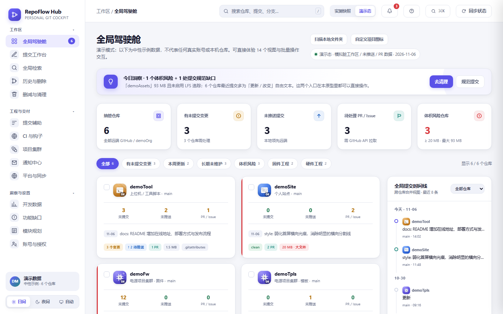
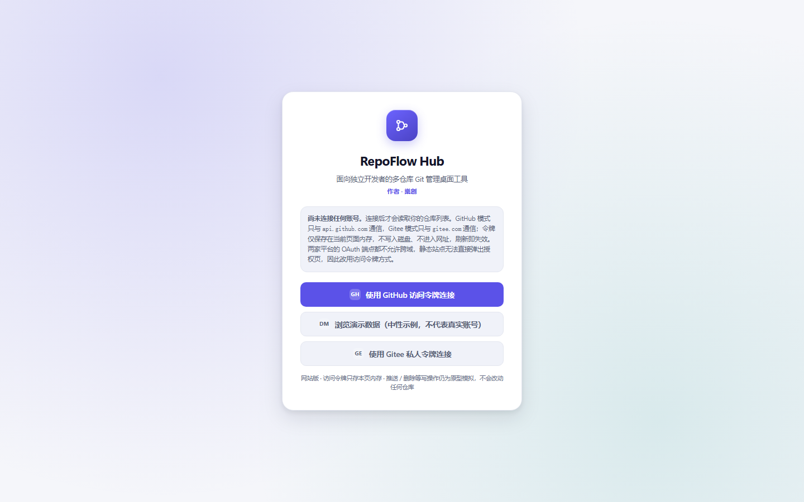
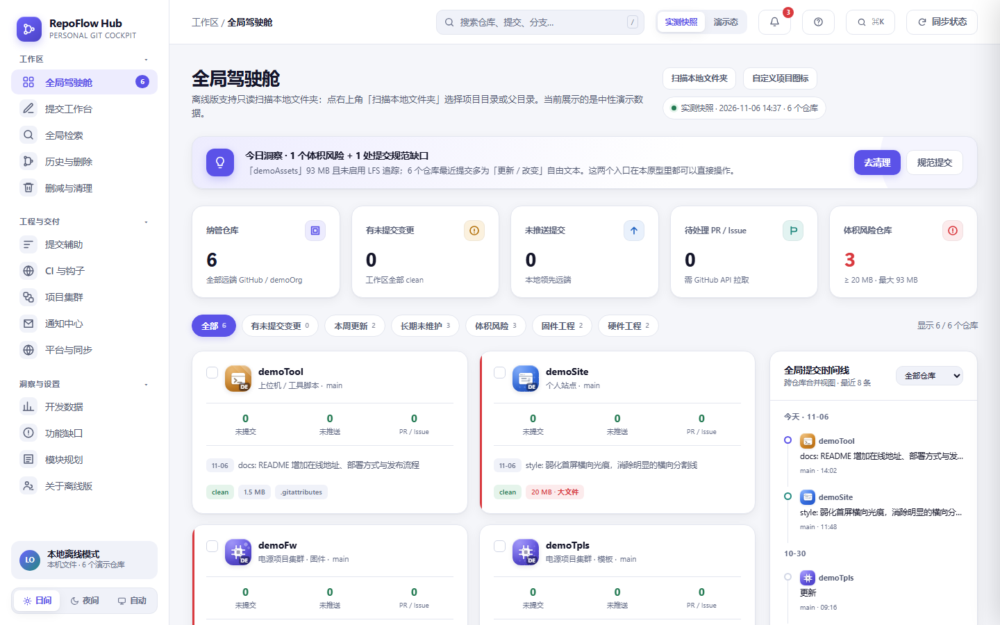

# RepoFlow Hub

**面向独立全栈开发者的多仓库 Git 管理工具** · 单文件、零依赖、只读扫描的高保真交互原型。

[](https://github.com/LeChuangDev/RepoFlow-Hub/releases/latest)
[](https://github.com/LeChuangDev/RepoFlow-Hub)
[](https://github.com/LeChuangDev/RepoFlow-Hub)

在线体验：https://github.zhangwenle.com/ · 离线下载：[Releases](https://github.com/LeChuangDev/RepoFlow-Hub/releases/latest)



作者：**樂創**（[LeChuangDev](https://github.com/LeChuangDev)）

---

## 目录

- [30 秒上手](#30-秒上手)
- [两种形态](#两种形态)
- [下载与安装](#下载与安装)
- [使用教程](#使用教程)
- [功能真实度](#功能真实度)
- [功能视图](#功能视图)
- [常见问题](#常见问题)
- [数据与隐私](#数据与隐私)
- [目录结构](#目录结构)
- [本地开发](#本地开发)
- [发布与部署](#发布与部署)

## 30 秒上手

| 你想做什么 | 怎么做 |
| --- | --- |
| 先看看长什么样 | 打开 https://github.zhangwenle.com/?demo=1 ，直接进入演示模式 |
| 管理自己的 GitHub / Gitee 仓库 | 网页版粘贴访问令牌，读取真实仓库列表 |
| 盘点本机项目 | 下载离线版 → 解压启动 → 点「扫描本地文件夹」 |
| 断网 / 分发给别人 | 用离线版，不联网、无需登录 |

## 两种形态

| | 网站版（Web） | 离线版（Windows / Linux） |
| --- | --- | --- |
| 使用方式 | 粘贴 GitHub / Gitee 令牌读取真实仓库；也可浏览演示数据 | 解压即用，无需登录、不联网；可扫描本地文件夹 |
| 数据来源 | 远端仓库列表（只读）；令牌仅存页面内存 | 本机 `.git` 只读扫描；未扫描时展示中性演示数据 |
| 适合 | 在线演示、多设备查看 | 分发给别人、断网环境、本机仓库盘点 |

两个版本都是**单文件 HTML**、零外部依赖、零第三方框架。网站版只在主动连接平台时请求 `api.github.com` 或 `gitee.com`；离线版完全不联网。

## 下载与安装

- Windows x64：`RepoFlow-Hub-<版本>-windows-x64.zip` → 解压后双击 `start.cmd`
- Linux x64：`RepoFlow-Hub-<版本>-linux-x64.tar.gz` → 解压后 `chmod +x start.sh && ./start.sh`
- 每个 Release 附带 `SHA256SUMS.txt`，可执行 `sha256sum -c SHA256SUMS.txt` 校验
- 包内自带 `README.txt`，解压即可看到启动步骤

需要本机已安装 Chrome / Chromium / Edge 提供 App 窗口；缺失时会退回系统默认浏览器打开 `app/index.html`。

## 使用教程

### 1. 打开应用

- 网页版：浏览器访问 https://github.zhangwenle.com/
- 离线版：Windows 双击 `start.cmd`；Linux 执行 `./start.sh`

首次打开会看到登录门（离线版自动进入本地模式，不显示登录门）：



### 2. 连接 GitHub（可选）

1. 点「使用 GitHub 访问令牌连接」。
2. 打开 https://github.com/settings/tokens?type=beta 新建 **Fine-grained token**：
   - **Repository access**：自己用选 `All repositories`，或只勾目标仓库
   - **Permissions**：只需 `Contents: Read`（`Metadata` 会自动包含）
   - 其余权限保持 `No access`
3. 复制令牌（`github_pat_...` 或 `ghp_...`）粘贴到输入框，点「连接并读取仓库」。
4. 成功后侧栏显示 `账号名 · GitHub · N 个仓库`，卡片换成真实仓库。

令牌只存在当前页面内存：不写 localStorage、不进 cookie、不出现在网址，刷新即失效。GitHub 的 OAuth 端点不允许跨域，静态站点无法弹出授权页，因此采用访问令牌方式。

### 3. 连接 Gitee（可选）

1. 点「使用 Gitee 私人令牌连接」。
2. 打开 https://gitee.com/personal_access_tokens 生成私人令牌，勾选 `projects` 权限。
3. 粘贴令牌，点「连接并读取仓库」。

Gitee 开放 API 允许跨域，所以同样可以纯前端完成；令牌只随 HTTPS 发往 `gitee.com`，不落盘。

### 4. 扫描本地文件夹（离线版核心能力）



1. 点驾驶舱右上角 **扫描本地文件夹**。
2. 选择单个项目目录，或包含多个仓库的父目录（会自动向下找一级/二级子仓库）。
3. 应用只读读取 `.git` 里的 `HEAD / config / refs / logs / COMMIT_EDITMSG`，得到仓库名、当前分支、远端地址、最近提交与分支数。
4. 扫描后侧栏显示「文件夹名 · 本地文件夹 · N 个仓库」，快照显示「本地扫描 · N 个仓库 · 只读」。
5. 点「同步状态」可重新扫描上次选择的目录。

**限制**：脏工作区、未推送提交、准确 `.git` 体积必须真正运行 git 才能得到，页面统一显示 0 或「—」，不伪造数据。

**浏览器差异**：Chrome / Edge 使用目录选择器；Firefox / Safari 或部分 `file://` 场景会自动退回文件夹选择（`webkitdirectory`），效果相同。`node_modules`、`dist`、隐藏目录会被跳过。

### 5. 演示模式

不想连接账号、也没有本地仓库时：

- 在线直接访问 https://github.zhangwenle.com/?demo=1
- 或在登录门点「浏览演示数据」

演示数据全部是中性示例，侧栏会标注「演示数据 · 中性示例」，不会冒充真实账号。

### 6. 退出与清理

侧栏账号卡片或「账号与授权」页可撤销授权。退出会清空内存中的令牌并恢复演示数据；网页版回到登录门。

## 功能真实度

| 能力 | 状态 | 说明 |
| --- | --- | --- |
| GitHub / Gitee 登录 | ✅ 真实 | 访问令牌校验、拉取账号与仓库列表、手动刷新 |
| 全局检索 | ✅ 真实 | 连接后检索真实仓库；演示模式检索内置索引 |
| 本地文件夹扫描 | ✅ 真实 | 只读解析 `.git` 文本文件 |
| 主题 / 筛选 / 分页 / 批量选择 | ✅ 真实 | 纯前端交互，状态保存在本机 localStorage |
| 推送 / 拉取 / 提交 | ⚠️ 模拟 | 只有命令预览与三档确认，不执行 Git 写操作 |
| 删除仓库 / 删除推送记录 | ⚠️ 模拟 | 仅界面演示，不改动本地或远端 |
| 提交历史 / CI / 通知 / 平台同步 | ⚠️ 示例 | 未接入对应 API，界面明确标注为示例 |

> 连接真实账号后，页面顶部会常驻「已连接远端（只读）」提示条，说明哪些是实时数据、哪些仍是示例。

## 功能视图

全局驾驶舱 · 提交工作台 · 全局检索 · 历史与删除 · 删减与清理 · 提交辅助 · CI 与钩子 · 项目集群 · 通知中心 · 平台与同步 · 开发数据 · 功能缺口 · 模块规划 · 账号与授权，共 14 个视图。

- **批量操作**：跨仓库选择、批量拉取/推送/提交，执行前有 dry-run 预览
- **CI 与钩子**：固件 CI、pre-commit、自定义钩子的模板与运行结果
- **平台与同步**：GitHub / Gitee 双远端策略，同一提交分别推送
- **项目图标**：配色、图形、文字、本地图片自定义
- **主题**：日间冷白 + 夜间黑蓝，跟随系统或手动切换

## 常见问题

| 现象 | 原因与处理 |
| --- | --- |
| 令牌报 401 | 复制不完整、已过期或被撤销，重新生成 |
| 令牌报 403 | GitHub 令牌未勾选目标仓库 / 组织仓库未批准 SSO；Gitee 令牌缺 `projects` 权限 |
| 只显示公开仓库 | GitHub 的 Repository access 选的是 `Public repositories`，改为 All 或勾选具体仓库 |
| 扫描不到仓库 | 确认所选目录或一级/二级子目录里有 `.git`；`node_modules`、`dist`、隐藏目录会被跳过 |
| 文件夹选择没反应 | 浏览器不支持目录选择器，等它自动退回文件夹上传选择；建议用 Chrome / Edge |
| 部署后页面没更新 | EdgeOne 部署或 CDN 缓存滞后：控制台重新部署并刷新缓存，确认部署记录里的提交哈希是最新 |
| 离线版启动被拦截 | 杀毒软件误报 `start.cmd`，右键允许运行或加入白名单 |

## 数据与隐私

- 静态页面不保存、不转发令牌；账号与仓库数据只在页面内存中，刷新即清空。
- 本地扫描只申请只读权限，不写入、不上传任何文件。
- 公开产物由 `templates/sanitize.py` 脱敏：账号名、真实仓库清单、本机路径、提交短哈希替换为中性示例值。
- 离线版不联网、不加载远程字体 / 脚本 / 图片 / 统计代码。
- 网站版 CSP 只放行 `api.github.com` 与 `gitee.com` 两个连接目标。

## 目录结构

```
src/
  shell.html            页面骨架（含占位符 @@CSS@@ / @@CONFIG@@ / @@JS@@）
  styles/               01-tokens → 08-about，按序拼接
  data/                 版本常量、示例快照、内置常量
  core/                 渲染、状态、交互、账号、远端登录、本地扫描等模块
  selftest.js           内置自检，仅 ?selftest=1 时运行
templates/              固件 CI / pre-commit / 钩子三份内嵌配置 + 脱敏脚本
scripts/build.py        单文件构建器（dev / web / desktop 三个目标）
scripts/verify.py       静态校验 + 可选浏览器自检
scripts/package.py      生成 Windows / Linux 离线安装包与 SHA256SUMS
docs/screenshots/       README 使用的界面截图
web/                    网站构建产物
desktop/                离线版启动脚本与产物
prototype/              本机开发副本（含实测数据，不对外分发）
```

## 本地开发

需要 Python 3.10+（无第三方依赖）：

```bash
python scripts/build.py                 # 构建全部三个目标
python scripts/build.py --target=web    # 只构建网站版
python scripts/build.py --check         # 比对源码与产物是否一致
python scripts/verify.py                # 静态校验
python scripts/verify.py --browser      # 追加无头浏览器交互自检（235 条）
npm run package                         # 生成 dist/ 下的安装包与校验和
```

`prototype/index.html`、`web/index.html`、`desktop/app/index.html` 均由源码拼接生成，**不要手工编辑产物**。

## 发布与部署

推送 `v*` tag 自动构建两套离线包、生成校验和并发布 Release：

```bash
git tag v0.8.4
git push origin v0.8.4
```

网站版部署到 EdgeOne Pages：

```bash
npx edgeone login
npx edgeone makers deploy ./web -n repoflow-hub -e production -a overseas
```

仓库根目录的 `edgeone.json` 定义安全响应头（CSP、HSTS、nosniff、X-Frame-Options 等）与 HTML 不缓存策略（EdgeOne 只读取项目根目录的该文件，放在输出目录不生效）。未备案域名请使用海外区域；Git 导入项目由 EdgeOne 自动构建部署，GitHub Actions 的 CLI 部署为手动兜底。

> 使用跳过构建的 Git 项目时（构建命令 `echo prebuilt`），修改源码后必须本地执行 `python scripts/build.py` 并把 `web/index.html` 一并提交，否则线上仍是旧产物。
